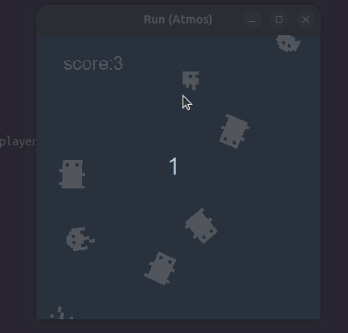
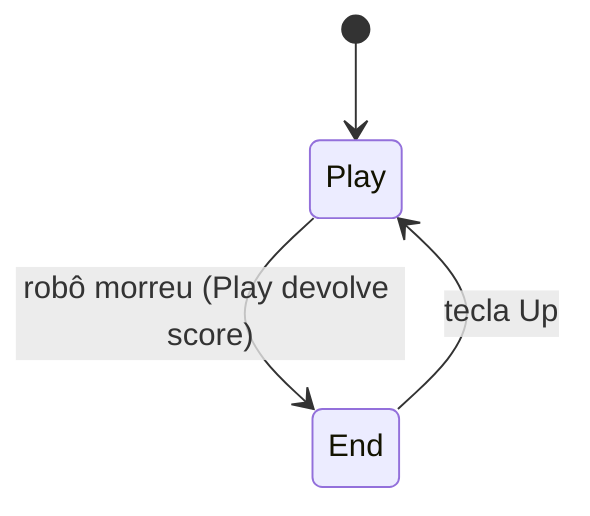
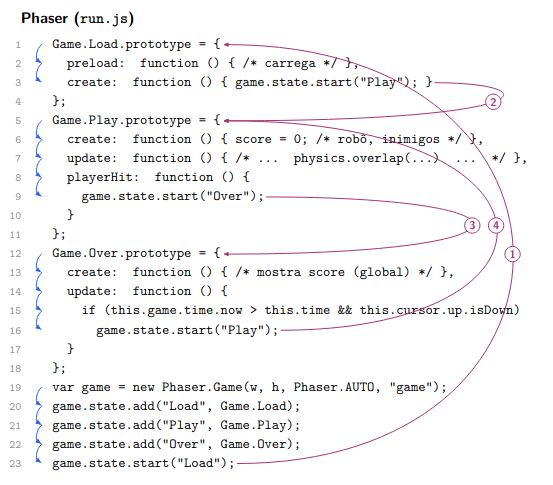
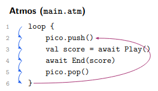
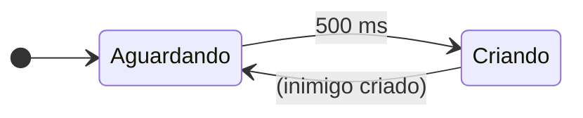
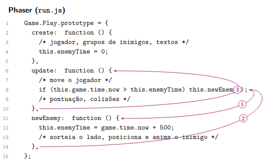
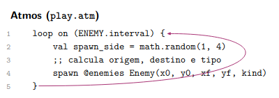
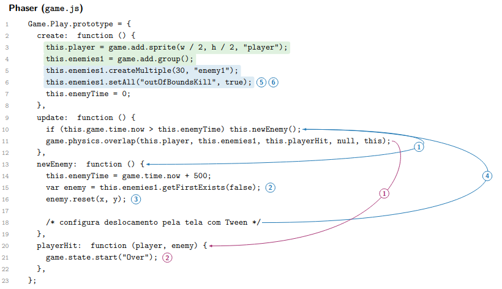
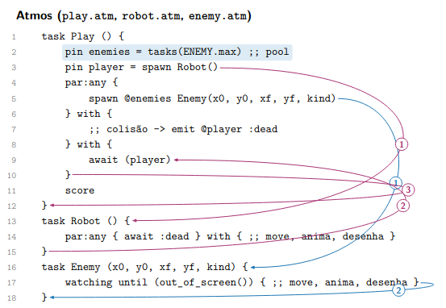
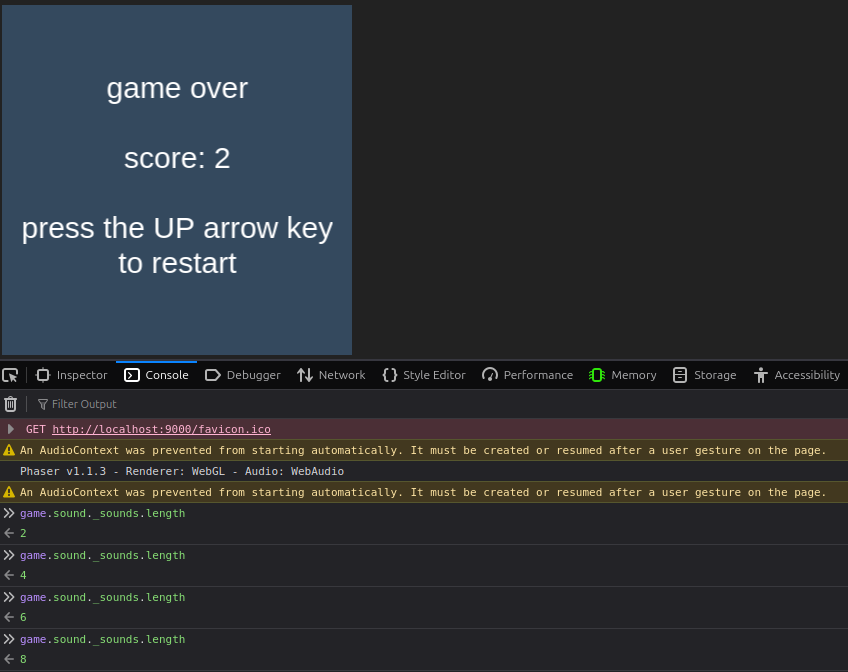

# Run



Port do jogo **Run!** do desafio *12 Games in 12 Weeks* (Lessmilk), de Phaser para a linguagem Atmos.

## Versões

| Ferramenta | Versão |
|---|---|
| **Atmos**| 0.8 |
| **pico-sdl** | 0.7 |
| **Phaser (original)** | 1.1.3 |

## Instruções

- O jogador controla um robô com as **setas** do teclado, nas quatro direções;
- A cada **500 ms** surge um inimigo de um lado arbitrário atravessando a tela em linha reta;
- O jogador ganha **1 ponto por segundo** enquanto estiver vivo.
- Colidir com o inimigo encerra a partida.

## 1. Fluxo das telas `main.atm`



No Phaser, o fluxo era dividido em três *states* (`Load`, `Play`, `Over`) alternados por `game.state.start(...)` e a pontuação residia em uma variável global. Em Atmos, o fluxo é lido como um laço infinito sequencial, e a pontuação é obtida com o valor de retorno de `Play` em cada iteração.




A transição entre as telas do Run é um caso do padrão de `continuation passing`: a conclusão de uma atividade longa carrega consigo a ação a ser executada em seguida. Na versão em Phaser, cada state carrega a indicação de qual será a próxima tela. Load termina com `game.state.start("Play")`, o callback playerHit dentro de Play chama `game.state.start("Over")` e Over devolve o controle a Play da mesma forma. A pontuação sobrevive a essas trocas pois está armazenada em uma variável global. **A ordem das telas não aparece em nenhum ponto do código e precisa ser reconstruida seguindo os saltos de um trecho do arquivo a outro**, como mostra a figura acima.

Em Atmos, essa leitura é sequencial e o único salto é a própria volta do laço.

## 2. Play `play.atm`

```
task Play () {
    pin enemies = tasks(ENEMY.max)  ;; pool de inimigos
    pin player  = spawn Robot() ;; o jogador
    var score   = 0

    spawn { ;; texto "use the arrow keys to move"
        par:any {
            ;; desenha o texto com transparência alpha
        } with {
            ;; espera tecla Up, faz o fade em LABEL_FADE e texto some
        }
    }

    par:any {
        ;; a cada SCORE_PERIOD soma score + 1
    } with {
        ;; desenha o placar
    } with {
        ;; a cada ENEMY.interval sorteia lado de surgimento e tipo de inimigo
    } with {
        ;; verifica se houve colisão entre player e inimigos -> emit @player :dead
    } with {
        ;; espera o robô terminar (await player) e toca o som de batida
    }
    score   ;; score é repassado como valor de retorno
}
```


## 3. Robot `robot.atm`

```
task Robot () {
    par:any {
        ;; espera :dead (vindo de Play quando há colisão)
    } with {
        ;; controla movimento
    } with {
        ;; controla direção do sprite
    } with {
        ;; desenha o robô
    }
}
```

---

## 4. Enemy `enemy.atm`

```
task Enemy (x0, y0, xf, yf, kind) {
    watching until (out_of_screen()) {  ;; termina quando sai da tela
        par {
            ;; movimento (atravessa a tela em ENEMY.travel segundos)
        } with {
            ;; a cada ENEMY.anim alterna o quadro da animação
        } with {
            ;; desenha rotacionado na direção do movimento
        }
    }
}
```

Ao terminar, a task sai do pool `enemies`. No Phaser isso era feito manualmente com
`outOfBoundsKill` e `getFirstExists(false)` (reaproveitamento de sprites).

---

## 5. End `end.atm`

```
task End (score) {
    par:any {
        ;; desenha "Game Over", a pontuação e a instrução
    } with {
        ;; espera o usuário apertar Up para reiniciar a partida
    }
}
```

---
# Padrões

## Hierarquia de Despacho
As entidades do jogo formam uma hierarquia em que uma pode conter outras. Quando uma informação chega, como a ocorrência de um evento ou a passagem de um quadro (update), ela precisa ser repassada em cadeia até as entidades mais internas (filhas). Sant'Anna (2018) chama esse padrão de hierarquia de despacho (dispatching hierarchy).

Frameworks têm uma parte já implementada, como o game loop e funcionalidades comuns às aplicações do domínio, e outra que precisa ser escrita pelo programador. Nesse sentido, **o framework absorve parte da complexidade daquilo que ele próprio sabe fazer**. Comportamentos que fogem do que ele oferece precisam ser escritos à mão de forma que o conceito ainda precisa ser conhecido pelo programador para que ele seja capaz de implementa-los. O custo é reduzido, mas nunca zerado.

No caso da hierarquia de despacho, o Phaser já oferece a cada objeto, por exemplo, o que é preciso para movê-lo, animá-lo e desenhá-lo. Quando uma entidade tem regras próprias do jogo, como inverter o sentido da direção ao bater na borda da tela, o programador precisa adicionar o repasse dessa informação no código.

No Phaser, **parte da hierarquia de despacho só é visível no código do próprio framework**. A ordem de atualização dos objetos, tweens e o código do jogo a cada quadro só aparece no código-fonte, mudou entre as versões verificadas (1.1.3 e CE 2.20.2) e não é descrita na documentação. Ainda assim, a documentação do Phaser CE deixa explícito ao programador que esse repasse é responsabilidade dele: "Remember if this Game Object has any children you should call update on those too".

Run não tem hierarquia de despacho **explícita** no código em Phaser. Ou seja, o programador não especificou nada que o framework já não tenha fornecido como funcionalidade. O movimento dos inimigos via tween, a animação, a remoção fora da tela com `outOfBoundsKill` e o desenho são repassados a cada objeto pelo próprio Phaser. Até a colisão com `physics.overlap` tem o grupo percorrido pelo Phaser. **A hierarquia de despacho ocorre apenas do lado do framework**.

Em Atmos, **cada entidade é uma task capaz de especificar e aguardar os eventos aos quais reage**, de modo que o despacho em cadeia deixa de ser necessário.

## Máquinas de Estado
(desenvolver)
FSM da criação de inimigos


A versão 1.1.3 do Phaser, usada em nove dos doze jogos, ainda não oferecia temporizadores (`game.time.events`). Então, o mecanismo de controlar prazos com uso de variáveis testadas a cada update também apareceu em outros jogos da série. 




Quando o prazo estoura (1), o update chama newEnemy. newEnemy ajusta o prazo e retorna (2). No quadro seguinte, o update é chamado novamente pelo topo (3). Como enemyTime inicia em zero, o primeiro teste já é verdadeiro. create e update rodam quando chamados pelo framework e newEnemy pelo update. Em Atmos, esse comportamento fragmentado é reconciliado em 1 linha.

## Tempo de vida

### Tempo de vida do robô e dos inimigos do tipo 1



As setas em vinho representam os saltos do robô e as azuis os do inimigo. Em destaque azul, a criação da pool de inimigos e a configuração do `outOfBoundsKill`. Em destaque verde, as atribuições que o próximo `create` sobrescreve.

Na versão em Phaser, **o tempo de vida de um inimigo fica fragmentado entre o create, o newEnemy, a verificação do framework e a troca de tela (ou state)**.

No create (linha 5), o `createMultiple` cria 30 sprites de entidades "mortas" para gerar uma pool. O uso de pools é recomendado pela própria documentação e é uma prática comum para a criação de entidades numerosas (como esses inimigos ou bullets, por exemplo). Um sprite é um objeto "faz tudo" que pode se mover, colidir, ser animado e ser clicado, e o construtor já monta tudo isso de antemão, sem perguntar se o jogo vai usar todas essas funções. Então, os sprites ocupam memória e são criados com corpo físico (Phaser.Physics.Arcade.Body), sinais de eventos (onKilled, onRevived, onOutOfBounds) e gerenciador de animações.

**Inimigo**
1. A cada 500ms, o update chama o método `newEnemy` para criar um novo inimigo;
2. O `getFirstExists(false)` devolve o primeiro objeto da pool marcado como não existente (exists = false);
3. O reset o coloca na posição sorteada, atribuindo true às flags de existente, visível e vivo (exists, visible, alive).
4. O newEnemy retorna ao update.
5. Com o `outOfBoundsKill` configurado (linha 6), o motor chama `kill` assim que o inimigo sai da tela.
6. O `kill` faz o inverso do reset e atribui false nas flags alive, exists e visible. O inimigo "morre", mas o objeto continua na pool.

A documentação indica que essa é uma forma de reciclar o objeto numa pool, sem destruí-lo ou liberar memória. A ideia é evitar criar e descartar objetos durante a partida (possivelmente para evitar problemas de desempenho com o coletor de lixo). O inimigo continua no grupo, "morto", à espera do próximo `getFirstExists`, o que faz com que **a diferença entre um sprite nascer e morrer seja trocar o valor de flags**.

> A informação de vida e morte da entidade está representada em três flags: exists, alive e visible. O `getFirstExists(false)` olha apenas a flag exists. O `reset` atribui true às três flags e o `kill`, false. Um sprite "morto" não é atualizado pelo framework, nem entra nos testes de colisão, por exemplo. Nascer e morrer é basicamente trocar booleanos em um objeto que nunca sai do grupo.

O `kill` também pode ser chamado pelo programador, é um método público. Em Run, no entanto, o programador optou apenas por configurar o `outOfBoundsKill` que faz o `kill` implicitamente ("mata" quando o objeto sai da tela).

**Robô**

1. O `overlap`, chamado no update, detecta a colisão e chama o callback `playerHit`;
2. O `playerHit` chama `state.start("Over")`.

O `playerHit` só pede a transição de estado e o robô nunca recebe `kill`. Dessa forma, as flags internas não mudam e ele termina a partida vivo.

O `state.start("Over")` transiciona para a tela de pontuação, limpando a árvore de objetos que o motor desenha e atualiza por quadro, mas não destrói nada.
O game.state.add("Play", Game.Play) cria um único objeto para a tela Play, que é o mesmo this do create e do update que é reaproveitado a cada partida.
Dessa forma, **o robô e os inimigos deixam de ser desenhados, mas continuam existindo em `this.player` e `this.enemies1` até que o próximo create sobrescreva os antigos com uma nova pool**.
(não há .destroy() nesses objetos durante a transição de tela, então eles sobrevivem e ficam inutilizados quando substituídos - coletor de lixo?).

---

**Resumo**

| Mecanismo | O que muda | Sai da tela? | Sai da memória? |
|---|---|---|---|
| `kill` | flags alive, exists e visible | sim | não, continua no grupo |
| `state.start` | sai da lista de exibição | sim | não, continua em `this.player` e `this.enemies1` |
| próximo `create` | `this.player` e `this.enemies1` passam a apontar para objetos novos | já tinha saído |
| `destroy` | anula as referências e destrói os tratadores de eventos e animações | sim | sim |

Morrer é trocar o valor das flags. Trocar de tela deixa de exibir mas não destrói os objetos. A saída da memória é um efeito colateral da nova atribuição no próximo create, que não está escrito em lugar nenhum. O fim dos objetos previsto pela documentação, o `destroy`, não é chamado nem pelo programador, nem pelo framework. Embora a criação da pool seja recomendada para evitar o uso do coletor de lixo, a cada partida a pool inteira é descartada e outra é criada. (isso parece ter mudado no Phaser2)

---



Em Atmos, **o tempo de vida está restrito ao próprio bloco de código**. A task termina quando o seu bloco termina e todas as atividades contidas nela também terminam.

**Inimigo**

1. O inimigo nasce como uma `task` dentro da pool enemies.
2. Quando sai da tela, o `watching` aborta o seu corpo, a task termina e sai da pool.

**Robô**

1. O robô nasce atrelado ao escopo de Play com o uso de pin.
2. Ao receber `:dead`, ele termina, e seu término é o próprio evento que acorda o `await (player)`.
3. Ao acordar, o `par:any` termina, `Play` retorna a pontuação para o laço principal, e tudo o que vivia nele (inimigos vivos e o robô) termina junto.

A princípio, o jogo Run não sofre com lapsed listener, pois as **teclas e o tempo são consultados a cada quadro e não há inscrições por parte do programador**. Mas **há um recurso que "acumula" durante a execução do jogo**. A cada rodada, um objeto de som é criado no `Play.create` e nunca usado, e outro é criado no `Over.create` e tocado uma vez na tela de pontuação. Os dois ficam registrados na lista do gerenciador de som (`game.sound._sounds`), que cresce em 2 a cada rodada e nunca diminui, conforme a figura. Ao contrário dos sprites, os sons não são recolhidos quando o próximo create sobrescreve a variável, porque o gerenciador continua guardando-os. Na versão 1.1.3 do Phaser, não há um meio de liberar esses objetos, e os exemplos oficiais que utilizam sons possuem uma única tela e não cobrem esse caso.



Na versão em Atmos, o som não acumula. O `pico-sdl` carrega os sons em cache (?) uma vez por rodada. O par `pico.push/pico.pop` libera o recurso em cada iteração do laço principal. No entanto, esse aspecto está mais relacionado ao funcionamento do pico-sdl do que ao da linguagem em si. O destaque de Atmos fica em **não precisar de inscrições e em ter o tempo de vida determinado pelo escopo no qual a variável ou task está inserida**.
